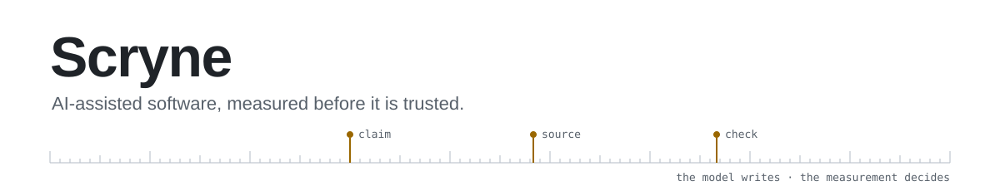

<picture>
  <source media="(prefers-color-scheme: dark)" srcset="assets/banner-dark.svg">
  
</picture>

I build software with AI as a pair programmer: document AI, OSINT tools, industrial
platforms, developer tooling. The model writes most of the first draft. What ships is
decided by tests, benchmarks and end-to-end runs on real data.

### How I work

| Principle | Where it shows |
|---|---|
| **Grounded or rejected.** An AI finding that cannot point to its source never reaches the user. | [TenderIQ](https://github.com/Scryne/TenderIQ): every finding carries document, page and clause, and is highlighted on the original PDF. |
| **Calibrate before you alarm.** Thresholds come from measured baselines, not intuition. | [GhostBuilding](https://github.com/Scryne/GhostBuilding): uncalibrated, 39 of 40 ordinary locations looked "anomalous". Calibrated on 60, a 27-site scan found 3, with 0 in the controls. |
| **Numbers from code, words from the model.** | [Wartrack](https://github.com/Scryne/Wartrack): the threat level and its reasons are computed; a local LLM only writes the Turkish summary. |
| **Audit your own green checks.** Passing CI is not the same as a working product. | [MythAtlas](https://github.com/Scryne/MythAtlas): CI was green while the content was fabricated. Citations went from 1,826 to 274, and a new gate flags 5,483 violations in the old data. |
| **Write decisions down.** Context lives in files, not in a chat window. | ADRs, `DESIGN.md` contracts and per-session status files in every project; [Kokpit](https://github.com/Scryne/Kokpit) is the desk I run it all from. |

### Selected work

| Project | What it is | Built with |
|---|---|---|
| [**TenderIQ**](https://github.com/Scryne/TenderIQ) | Citation-first analysis of Turkish public tender documents. Multi-tenant SaaS with row-level isolation, human-in-the-loop review and a golden-set eval gate. | FastAPI · Celery · PostgreSQL + pgvector · LangGraph · Next.js |
| [**GhostBuilding**](https://github.com/Scryne/GhostBuilding) | Compares three satellite imagery providers to flag blurred, mosaicked or mismatched locations, with the evidence tiles next to each score. | FastAPI · PostGIS · OpenCV · Next.js · MapLibre |
| [**Wartrack**](https://github.com/Scryne/Wartrack) | Single-operator monitoring board: 15 feeds mapped to places, scored events and an explainable threat level, summarized by a local model by default. | Node · Express · Socket.IO · SQLite · React · Leaflet · Ollama |
| [**MythAtlas**](https://github.com/Scryne/MythAtlas) | An open atlas of myths, deities and sacred sites, matched against Wikipedia and Wikidata, with UNESCO status verified per site. | Next.js · MapLibre · D3 · Wikidata SPARQL |
| [**Kokpit**](https://github.com/Scryne/Kokpit) | Desktop cockpit for AI-assisted development: every project on one board, one click opens Claude Code in an embedded terminal. | Electron · node-pty · xterm.js · React |

Also built, kept private: a compliance due-diligence platform (KYB screening with a hash-chained
audit trail), a multi-tenant MES/ERP for heavy industry, a political-intelligence desk whose
evidence engine is forbidden by CI from importing the LLM, and a local-first OSINT workstation.

### Toolbox

**Backend** Python · FastAPI · Celery · Node.js · PostgreSQL · pgvector · PostGIS · Redis · SQLite 
**Frontend** TypeScript · React · Next.js · Tailwind · MapLibre · Leaflet · D3 
**AI** Claude Code · LangGraph · RAG and hybrid retrieval · local models (Ollama) · eval sets 
**Quality** pytest · Vitest · Playwright · mypy · Ruff · GitHub Actions · Lighthouse · gitleaks
