<picture>
  <source media="(prefers-color-scheme: dark)" srcset="assets/hero-dark.svg">
  
</picture>

<a href="https://github.com/Scryne/citefield"><picture><source media="(prefers-color-scheme: dark)" srcset="assets/card-citefield-dark.svg"></picture></a>

<a href="https://github.com/Scryne/TenderIQ"><picture><source media="(prefers-color-scheme: dark)" srcset="assets/card-tenderiq-dark.svg"></picture></a>
<a href="https://github.com/Scryne/GhostBuilding"><picture><source media="(prefers-color-scheme: dark)" srcset="assets/card-ghostbuilding-dark.svg"></picture></a>

<a href="https://github.com/Scryne/MythAtlas"><picture><source media="(prefers-color-scheme: dark)" srcset="assets/card-mythatlas-dark.svg"></picture></a>
<a href="https://github.com/Scryne/Wartrack"><picture><source media="(prefers-color-scheme: dark)" srcset="assets/card-wartrack-dark.svg"></picture></a>

<a href="https://github.com/Scryne/gridgrade"><picture><source media="(prefers-color-scheme: dark)" srcset="assets/card-gridgrade-dark.svg"></picture></a>
<a href="https://github.com/Scryne/Kokpit"><picture><source media="(prefers-color-scheme: dark)" srcset="assets/card-kokpit-dark.svg"></picture></a>

<picture>
  <source media="(prefers-color-scheme: dark)" srcset="assets/plate-dark.svg">
  
</picture>

Every panel is drawn by <a href="https://github.com/Scryne/Scryne/blob/main/build/build.py">build/build.py</a>; the trace is redrawn daily from the public contribution calendar.
